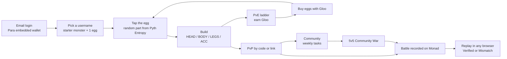
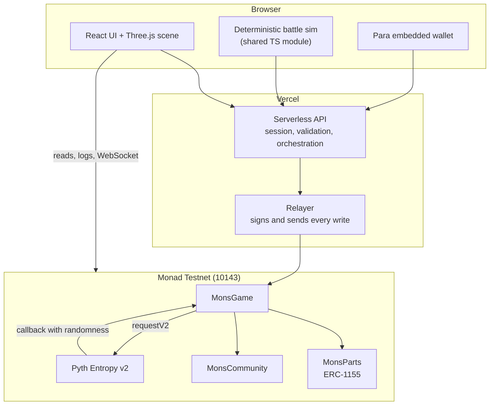

# MONSLAB

**A creature-builder auto-battler on Monad where the fights are real.** Assemble a monster from parts you own, battle other players, and let anyone replay the fight straight from chain.


## TL;DR

MONSLAB is a browser game on Monad testnet. You log in with an email, get a starter monster and an egg, hatch random parts, and build a monster across four slots: HEAD for attack, BODY for HP, LEGS for speed, and an accessory for looks. You grind a PvE ladder for Gloo, fight other players through a code or a link, join a community for weekly co-op goals, and take part in 5v5 Community Wars.

The player never sees a wallet popup or pays gas. Every write goes through a relayer, while ownership, gacha fairness, and battle results stay on-chain. Each battle is recorded on Monad with its seed and loadout snapshots, so anyone can re-run the same simulation in a clean browser without logging in and check whether the recorded result is genuine.

## The problem

Campus and Web3 communities in Indonesia are loud during an event and quiet two weeks later. There is no recurring activity that brings members back to play together.

The on-chain games that exist make it worse. They feel like filling out a form: install a wallet, buy gas, approve a transaction, wait. Most people leave before the first monster appears.

MONSLAB is built around the opposite idea. The game should feel like a game first. The chain does its job in the background, and when someone doubts the result, the chain can prove it.

## What you can do

| | |
| --- | --- |
| **Build** | 21 parts across 7 families and 4 slots. Mix families for a set bonus, or mix three different families for a chimera bonus. |
| **Hatch** | Eggs are opened with randomness from Pyth Entropy. The drop table and the roll both live in the contract. |
| **Battle** | 11 PvE tiers against arena monsters, or PvP against another player's on-chain loadout using their code. Your opponent does not have to be online. |
| **Fight with a type chart** | 6 elements in a circle: Water, Stone, Fire, Wind, Nature, Volt. Each part carries two. Clashing elements swing damage from 0.25x to 1.75x. |
| **Belong** | Communities of up to 30 members share two weekly goals: a themed win count and a group hatch count. |
| **War** | 5v5 between communities. Team members lock enemy targets; a lock shows up on every open board in under a second. |
| **Verify** | Every battle can be replayed from its on-chain record. The badge says `Verified` only when the re-simulation matches the contract's result hash. |

## The loop



## How a battle works

Battles are a two-step, relayer-driven flow. Neither the player nor the server gets to pick the outcome.

1. The API calls `startBattle(player, mode, ref)`. The contract snapshots both loadouts and derives a seed from `block.prevrandao`, the previous block hash, the battle id, and the player address, then emits `BattleStarted`.
2. The API reads the seed from the receipt and runs the same deterministic simulation the browser uses. The simulation is shared TypeScript code, imported by both the client and the serverless functions.
3. The API calls `finalizeBattle(battleId, outcome)`. The contract recomputes `keccak256(abi.encode(...))` over the outcome and rejects the transaction if the hash, the simulation version, or the battle state does not check out. Rewards are applied only after that check.
4. The browser replays the same simulation for animation. A battle opened via `/?replay=<battleId>` reads both events from chain, re-simulates, and compares winner, action count, HP, and the result hash.

Loading the replay needs no account and no API session. The record is the proof.

## Architecture



There is no database. Player state, part balances, battles, communities, and wars are contract storage. Sessions are a signed JWT in an httpOnly cookie. Anything list-shaped, such as communities or battle history, is read from logs with `eth_getLogs`.

The relayer model is the honest trade-off. Players get no popups and no gas, but the API holds several burner keys with `RELAYER_ROLE` and acts on the player's behalf. The contracts still re-check every rule, and every write emits an event.

## Tech stack

| Layer | Choice | Notes |
| --- | --- | --- |
| Frontend | Vite 6, React 19.2, TypeScript 5.8 (strict), Three.js 0.170, Tailwind 4 | PS1-style low-poly rendering in the browser |
| Wallet and auth | Para (`@getpara/react-sdk`) | Email, social, or external wallet, with an embedded wallet; the app session is a signed EIP-191 message turned into a JWT cookie |
| Chain client | viem 2, wagmi 3 | Reads, log queries, and WebSocket subscriptions with a polling fallback |
| Backend | Vercel Serverless Functions, Node 20 | One file per endpoint in `web/api/`, shared logic in `web/server/` |
| Contracts | Solidity 0.8.28, Foundry, OpenZeppelin v5 | `ERC1155`, `AccessControl`, custom errors, checks-effects-interactions |
| Randomness | Pyth Entropy v2 | Request and callback for every egg; the fee is paid by the relayer |
| Realtime | Monad WebSocket RPC | War board events; falls back to 1-second polling when the socket drops |
| Tests | Foundry, Vitest, Playwright | Contract invariants, simulation determinism, and one golden-path E2E run |

## Contracts on Monad testnet

| Contract | Address | Role |
| --- | --- | --- |
| `MonsGame` | [`0x1958fe3e3ffEa54b2D904b3fF680493179f96EF0`](https://testnet.monadscan.com/address/0x1958fe3e3ffEa54b2D904b3fF680493179f96EF0) | Players, loadouts, Gloo, eggs, battles, rewards, redeem drops |
| `MonsParts` | [`0xa9f7f4710Fe6cAdb95fDc016BE9B5Fa5fA26Aa31`](https://testnet.monadscan.com/address/0xa9f7f4710Fe6cAdb95fDc016BE9B5Fa5fA26Aa31) | ERC-1155 parts; starter tokens 101–103 are soulbound |
| `MonsCommunity` | [`0x4B1195A1922d4A3C23DF66699adA2261E820f485`](https://testnet.monadscan.com/address/0x4B1195A1922d4A3C23DF66699adA2261E820f485) | Communities, weekly tasks, wars, target locks, settlement |

| Network | Value |
| --- | --- |
| Chain | Monad Testnet, chain ID `10143` (`0x279f`) |
| RPC | `https://testnet-rpc.monad.xyz` |
| Explorer | `https://testnet.monadscan.com` |
| Deploy block | `73749222` |
| Simulation version | `1` |
| Pyth Entropy v2 | [`0x825c0390f379C631f3Cf11A82a37D20BddF93c07`](https://testnet.monadscan.com/address/0x825c0390f379C631f3Cf11A82a37D20BddF93c07) |

Token IDs in `MonsParts`:

| Range | Contents | Transferable |
| --- | --- | --- |
| `1..21` | Regular parts, indexed from the part table | Yes |
| `101, 102, 103` | Starter head, body, legs | No, soulbound |
| `201, 202, 203` | Event, community, and war accessories | Yes |

## Repository layout

```
.
├── contracts/          Foundry project
│   ├── src/            MonsGame.sol, MonsParts.sol, MonsCommunity.sol, interfaces/
│   ├── script/         Deploy.s.sol, SeedDemo.s.sol, export-abi.mjs, parts.json
│   ├── test/           Unit and invariant tests
│   └── deployments/    testnet.json (addresses only)
└── web/                Vite app and Vercel functions
    ├── api/            One file per endpoint
    ├── server/         Session, relayer, validation, battle orchestration
    ├── src/
    │   ├── chain/      viem clients, ABIs, reads, watchers, replay verifier
    │   ├── game/       Battle simulation, part data, renderer, engine
    │   ├── ui/         Screens and components
    │   └── state/      Client store
    ├── e2e/            Playwright golden path
    └── public/         Audio, metadata, static assets
```

## Run it locally

You need Node 20 or newer, pnpm, and Foundry (`forge`, `cast`, `anvil`).

```bash
git clone https://github.com/woydarko/monslab.git
cd monslab
```

### Web app

```bash
cd web
pnpm install
cp .env.example .env.local     # Windows: copy .env.example .env.local
pnpm dev
```

The app runs at `http://localhost:5183`. In dev, the Vite server also serves the handlers in `web/api/`, so you do not need a separate backend process. For an exact Vercel environment, run `vercel dev` instead.

`.env.local` needs the chain, contract, and Para values listed in `.env.example`. On the server side, `RELAYER_PRIVATE_KEYS` and `SESSION_SECRET` are required for any write endpoint. Never commit this file.

For local testing without an email inbox, set `VITE_FLAG_DEV_LOGIN=1`. That swaps Para for a burner key created per browser tab, and it must stay off in production.

### Contracts

```bash
cd contracts
forge build
forge test
```

To regenerate the ABIs that the web app imports:

```bash
node script/export-abi.mjs
```

If you change the part table, regenerate it from the web project first, since the deploy script reads `contracts/script/parts.json`:

```bash
cd web && pnpm gen:parts
```

### Deploy your own copy

```bash
cd contracts
cast wallet import monslab-deployer --interactive
RELAYER_ADDRESSES=0xabc...,0xdef... \
REDEEM_CODE=YOUR-EVENT-CODE \
forge script script/Deploy.s.sol \
  --rpc-url https://testnet-rpc.monad.xyz \
  --account monslab-deployer \
  --broadcast
```

The script refuses any chain other than `10143`. It writes `deployments/testnet.json`, wires the roles between the three contracts, and revokes the factory admin on `MonsParts` so no new parts can be minted outside the game and community contracts. Optional environment variables: `ENTROPY_ADDRESS`, `DROP_STARTS_AT`, `DROP_ENDS_AT`, `WEEK_LENGTH`, `WAR_DURATION`.

## Tests

```bash
# Contract unit and invariant tests
cd contracts && forge test -vv

# Web and server unit tests
cd web && pnpm test

# Type check and production build
cd web && pnpm build

# Determinism and balance sweep for the element system
cd web && pnpm balance:check

# End-to-end golden path against a preview build with VITE_FLAG_DEV_LOGIN=1
cd web && E2E_BASE_URL=<preview-url> pnpm e2e
```

The golden path covers title, register, egg hatch, equip, PvE battle, result, and a replay that should show `Verified`.

## What lives where

| On-chain | Off-chain |
| --- | --- |
| Part ownership, starter soulbound rule | Rendering and animation |
| Egg drop table and randomness | Session cookie and nonce signing |
| Gloo, Brain, daily caps, battle rewards | Friendly error messages and pre-checks |
| Battle seeds, loadout snapshots, result hashes | Battle orchestration (start, simulate, finalize) |
| Communities, weekly progress, war locks, settlement | Live board updates over WebSocket |
| Redeem code hashes and claim windows | Rate limiting per serverless instance |

The contract is the source of truth. The API exists to make the experience fast and the errors readable; it cannot overrule a revert.

## Known limitations

- **Testnet only.** Nothing is deployed to Monad mainnet.
- **Trusted relayers.** The API signs for players. A relayer could decline to finalize a battle, which would leave a `BattleStarted` without a `BattleFinalized` and no rewards.
- **Single owner key.** Deployment and owner functions use one EOA. There is no multisig or timelock yet.
- **Fallback randomness.** A contract-level owner switch can move egg randomness to a backend source if Entropy fails. That mode is trust-the-server and is currently off.
- **Transfer UI is not shipped.** Parts are transferable at the contract level, except starters.
- **No formal audit.** Review so far is AI-assisted only.
- **Not built yet:** marketplace, automated war matchmaking, battle simulation inside the contract, seasonal leaderboards, and any form of paid item.

## Context

Built by [nabil](https://github.com/woydarko) for **Monad Blitz Jogja Vol. 2** on 24 October 2026. The project is a solo build with AI agents working in parallel on contracts, platform, and frontend.

The game is meant to be played at a community meetup: one laptop on the big screen, one phone in the audience, and a war board that updates on both.
